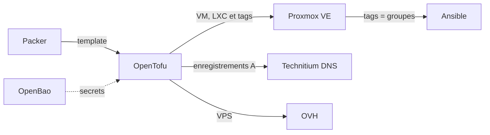

# OPENTOFU

<!--toc:start-->

- [Ce que fait le dépôt](#ce-que-fait-le-dépôt)
- [Adresses et identifiants](#adresses-et-identifiants)
- [Prérequis](#prérequis)
- [Secrets et state](#secrets-et-state)
- [Utilisation](#utilisation)
- [Garde-fous](#garde-fous)
- [Intégration continue](#intégration-continue)
- [Structure](#structure)

<!--toc:end-->

OpenTofu décrit les machines de mon homelab : les VM et les conteneurs LXC de
mon cluster Proxmox VE, leurs enregistrements DNS, ainsi qu'un VPS OVH.

C'est la deuxième partie de la chaîne : Packer construit les templates, OpenTofu
les clone pour créer les machines, puis Ansible les configure.



Les tags posés sur les machines deviennent les groupes de l'inventaire dynamique
d'Ansible : aucun fichier n'est échangé entre les deux outils.

## Ce que fait le dépôt

Deux _roots_, chacun avec son propre state :

| Dossier    | Ce qu'il gère                                                                    |
| ---------- | -------------------------------------------------------------------------------- |
| `proxmox/` | VM et LXC du cluster, description des nœuds, enregistrements DNS dans Technitium |
| `ovh/`     | VPS OVH hors site                                                                |

Les machines sont décrites comme des données, dans `proxmox/vms.auto.tfvars` et
`proxmox/lxcs.auto.tfvars` : ajouter une machine revient à ajouter une entrée,
sans toucher au code. Un modèle commenté en tête de `vms.auto.tfvars` liste les
options disponibles.

Trois modules font le travail :

| Module           | Rôle                                                                                       |
| ---------------- | ------------------------------------------------------------------------------------------ |
| `proxmox-vm`     | VM clonée depuis un template Packer (ou installée depuis un ISO), cloud-init, disques, GPU |
| `proxmox-lxc`    | Conteneur LXC                                                                              |
| `technitium-dns` | Un enregistrement A par machine, créé et supprimé par l'API de Technitium                  |

Chaque machine reçoit aussi une description générée, affichée dans Proxmox
(`vm-description.md.tftpl`, `lxc-description.md.tftpl`).

## Adresses et identifiants

L'adresse IP et l'identifiant Proxmox d'une machine sont calculés à partir d'un
seul nombre, son `host_id` :

- **IP** : `10.86.{segment}.{host_id}`
- **VMID** : `{segment}{host_id sur deux chiffres}`

Avec le segment 30 de la prod, `host_id = 31` donne l'IP `10.86.30.31` et le
VMID `3031`. Une machine se retrouve ainsi au même numéro dans Proxmox, sur le
réseau et dans le DNS.

## Prérequis

- **Nix** avec les flakes activés, et **direnv**.
- **rbw** (client Bitwarden CLI) : il fournit les identifiants AppRole
  d'OpenBao, du bucket S3 et de l'API OVH.
- Un accès réseau à **OpenBao**, à l'**API Proxmox**, à l'**API Technitium** et
  aux nœuds en SSH (le provider Proxmox s'en sert pour certains envois de
  fichiers).

Les outils (opentofu, tflint, pre-commit, gitleaks) ne sont pas à installer :
ils sont fournis par le `flake.nix`, en versions figées par `flake.lock`.

## Secrets et state

Aucun secret n'est stocké dans ce dépôt.

- Le **token API Proxmox** et le **token Technitium** sont lus dans OpenBao par
  des ressources `ephemeral` : ils sont relus à chaque exécution et ne sont
  jamais écrits, ni dans le state ni dans le plan.
- À l'entrée dans le dossier, `.envrc` lit dans Bitwarden via rbw les
  identifiants de l'AppRole `opentofu`, du bucket S3 et de l'API OVH, et les
  exporte pour OpenTofu.
- Le **state** est stocké dans un bucket S3 chez OVH, avec verrouillage natif
  (`use_lockfile`) : deux exécutions simultanées ne peuvent pas l'écrire en même
  temps.

## Utilisation

```bash
direnv allow     # une seule fois : charge l'environnement et les identifiants
cd proxmox       # ou ovh
tofu init        # télécharge les providers aux versions du lockfile
tofu plan        # montre ce qui changerait, sans rien modifier
tofu apply       # applique, après relecture du plan
```

Les fichiers `.terraform.lock.hcl` sont versionnés : ils fixent la version
exacte et les empreintes des providers, pour que le poste de travail et la CI
utilisent les mêmes.

## Garde-fous

- **Redémarrages visibles au plan** : un changement de CPU, de mémoire, de GPU
  ou de réseau impose de redémarrer la VM. Le module `proxmox-vm` le signale par
  une ressource `reboot_expected` : si elle apparaît dans le plan, l'apply va
  redémarrer la machine.
- **Contrôle du GPU** : avant de placer une VM en passthrough, OpenTofu vérifie
  que le nœud visé possède bien une carte graphique, et s'arrête avec le nom du
  nœud sinon.
- **`cloud-init-common.yaml` est exclu des hooks de nettoyage** : son contenu
  est comparé octet par octet, et un simple espace retiré ferait recréer toutes
  les VM.

## Intégration continue

La CI tourne sur Forgejo Actions, sur un runner sans root qui exécute ses jobs
dans Podman.

| Workflow | Déclencheur                           | Ce qu'il fait                                                                 |
| -------- | ------------------------------------- | ----------------------------------------------------------------------------- |
| `ci.yml` | push sur une branche autre que `main` | gitleaks sur les commits de la branche, puis pre-commit sur tous les fichiers |

Le pre-commit lance notamment `tofu fmt` et `tflint` sur les deux roots et les
modules. Les mises à jour des providers sont proposées par Renovate.

## Structure

| Élément                                       | Rôle                                                      |
| --------------------------------------------- | --------------------------------------------------------- |
| `proxmox/main.tf`                             | Calcul des adresses, appel des modules                    |
| `proxmox/providers.tf`                        | Providers, backend S3 et lecture des secrets dans OpenBao |
| `proxmox/variables.tf`                        | Déclaration des variables                                 |
| `proxmox/vms.auto.tfvars`, `lxcs.auto.tfvars` | Inventaire des machines                                   |
| `proxmox/common.auto.tfvars`                  | URL de Proxmox et clés SSH publiques                      |
| `proxmox/cloud-init-common.yaml`              | Cloud-init commun à toutes les VM                         |
| `ovh/`                                        | VPS OVH                                                   |
| `modules/`                                    | Modules réutilisables                                     |
| `flake.nix`, `flake.lock`                     | Environnement de développement reproductible              |
| `.envrc`                                      | Chargement de l'environnement et des identifiants         |
| `.pre-commit-config.yaml`                     | Contrôles automatiques avant chaque commit                |

## Licence

[MIT](LICENSE)
