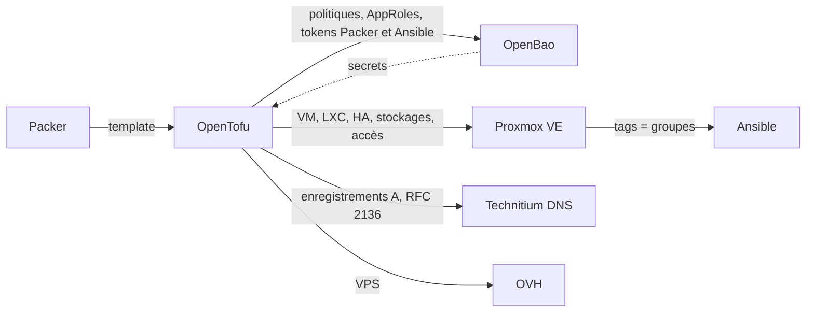

# OPENTOFU

<!--toc:start-->

- [Ce que fait le dépôt](#ce-que-fait-le-dépôt)
- [Le cluster Proxmox en code](#le-cluster-proxmox-en-code)
- [Adresses et identifiants](#adresses-et-identifiants)
- [Accès et tokens](#accès-et-tokens)
- [Prérequis](#prérequis)
- [Secrets et state](#secrets-et-state)
- [Utilisation](#utilisation)
- [Garde-fous](#garde-fous)
- [Intégration continue](#intégration-continue)
- [Ce qui reste hors du code](#ce-qui-reste-hors-du-code)
- [Structure](#structure)

<!--toc:end-->

OpenTofu décrit mon homelab : le cluster Proxmox VE (machines, mais aussi
stockages, sauvegarde, haute disponibilité, réplication et accès), les
enregistrements DNS des machines, la configuration d'OpenBao et un VPS OVH.

C'est la deuxième partie de la chaîne : Packer construit les templates, OpenTofu
les clone pour créer les machines, puis Ansible les configure.



Les tags posés sur les machines deviennent les groupes de l'inventaire dynamique
d'Ansible : aucun fichier n'est échangé entre les deux outils.

## Ce que fait le dépôt

Trois _roots_, chacun avec son propre state :

| Dossier    | Ce qu'il gère                                                                                  |
| ---------- | ---------------------------------------------------------------------------------------------- |
| `proxmox/` | Le cluster Proxmox : machines, stockages, sauvegarde, HA, réplication, accès, DNS des machines |
| `openbao/` | La configuration d'OpenBao : moteur `secret/`, méthodes d'auth, politiques, AppRoles           |
| `ovh/`     | VPS OVH hors site                                                                              |

Les machines sont décrites comme des données, dans `proxmox/vms.auto.tfvars` et
`proxmox/lxcs.auto.tfvars` : ajouter une machine revient à ajouter une entrée,
sans toucher au code. Un modèle commenté en tête de `vms.auto.tfvars` liste les
options disponibles.

Trois modules font le travail :

| Module        | Rôle                                                                                       |
| ------------- | ------------------------------------------------------------------------------------------ |
| `proxmox-vm`  | VM clonée depuis un template Packer (ou installée depuis un ISO), cloud-init, disques, GPU |
| `proxmox-lxc` | Conteneur LXC                                                                              |
| `dns-records` | Un enregistrement A par machine, mis à jour en RFC 2136 avec une clé TSIG                  |

Chaque machine reçoit aussi une description générée, affichée dans Proxmox
(`vm-description.md.tftpl`, `lxc-description.md.tftpl`).

## Le cluster Proxmox en code

Au-delà des machines, `proxmox/` décrit le cluster lui-même :

| Fichier          | Contenu                                                                                                 |
| ---------------- | ------------------------------------------------------------------------------------------------------- |
| `cluster.tf`     | Options du datacenter (CRS `dynamic` avec rééquilibrage automatique, migration), mapping PCI `gpu-intel` |
| `storages.tf`    | Les six stockages : `local`, `local-LVM`, `local-LVM2`, `local-ZFS`, `nas-ressources` (NFS), `nas-backup` (PBS) |
| `backup.tf`      | La sauvegarde quotidienne vers PBS                                                                      |
| `ha.tf`          | Ressources HA, règle `zfs-nodes` (HA limitée aux nœuds ZFS), règle `traefik-apart`                      |
| `replication.tf` | Réplication ZFS entre meganode et supernode                                                             |
| `access.tf`      | Utilisateurs, groupe `admin`, rôle `Packer`, ACL et tokens API                                          |
| `apt.tf`         | Dépôt `pve-no-subscription` activé sur chaque nœud                                                      |

La plupart de ces réglages se déclarent **sur la machine elle-même**, dans les
`.tfvars`, et le code en déduit le reste :

| Attribut          | Effet                                                                                              |
| ----------------- | -------------------------------------------------------------------------------------------------- |
| `protection`      | Protection Proxmox contre la suppression (`true` par défaut)                                       |
| `backup`          | La machine fait partie de la sauvegarde quotidienne                                                |
| `ha`              | État HA (`started`, `stopped`, `ignored`, `disabled`) ; absent = pas de HA                         |
| `replicate`       | Réplication ZFS vers l'autre nœud ZFS, calculé automatiquement                                     |
| `gpu_passthrough` | Passthrough de l'iGPU via le mapping `gpu-intel` ; exclut aussi la VM du rééquilibrage automatique |
| `tags`            | Groupes Ansible ; le tag `traefik` place la VM dans l'anti-affinité `traefik-apart`                |

Les nœuds sont déclarés une seule fois, dans `var.nodes`
(`proxmox/common.auto.tfvars`) : adresse et template Packer de chacun.

## Adresses et identifiants

L'adresse IP et l'identifiant Proxmox d'une machine sont calculés à partir d'un
seul nombre, son `host_id` :

- **IP** : `10.86.{segment}.{host_id}`
- **VMID** : `{segment}{host_id sur deux chiffres}`

Avec le segment 30 de la prod, `host_id = 31` donne l'IP `10.86.30.31` et le
VMID `3031`. Une machine se retrouve ainsi au même numéro dans Proxmox, sur le
réseau et dans le DNS.

## Accès et tokens

Aucun outil n'utilise de token de `root@pam`. Chaque outil a son compte
`<outil>@pve`, avec le minimum de droits :

| Compte                                    | Droits                  | Token                                                       |
| ----------------------------------------- | ----------------------- | ----------------------------------------------------------- |
| `opentofu@pve`                            | `Administrator` sur `/` | créé à la main, rangé dans `secret/opentofu/proxmox`         |
| `packer@pve`                              | rôle `Packer` sur `/`   | créé par OpenTofu, écrit dans `secret/packer/proxmox-token`  |
| `ansible@pve`                             | `PVEAuditor` sur `/`    | créé par OpenTofu, écrit dans `secret/ansible/proxmox-token` |
| `homarr@pve`, `prometheus@pve`, `pdm@pve` | `PVEAuditor` sur `/`    | créés à la main, collés dans chaque outil                    |

Les comptes de service sont dans `local.service_accounts` et les tokens gérés
par OpenTofu dans `local.managed_tokens` (`access.tf`). Un token géré suit la
convention `<outil>@pve!<outil>`, et sa partie secrète est écrite dans OpenBao à
`secret/<outil>/proxmox-token`, clé `token`, en attribut _write-only_.

Pour faire tourner un token géré :
`tofu apply -replace='proxmox_user_token.managed["<outil>"]'`, en incrémentant
sa `version` dans `local.managed_tokens`.

Le token d'OpenTofu est volontairement créé à la main : OpenTofu ne doit pas
pouvoir révoquer la clé avec laquelle il travaille. Les comptes humains `@pam`
(groupe `admin`) sont décrits en code, mais leur mot de passe, leur e-mail et
leur double authentification restent gérés hors d'OpenTofu.

## Prérequis

- **Nix** avec les flakes activés, et **direnv**.
- **rbw** (client Bitwarden CLI) : il ne fournit que le mot de passe du compte
  OpenBao, et garde une copie de secours de la passphrase du state et des clés
  S3.
- **bao** (CLI OpenBao) et **jq** : `.envrc` s'en sert pour se connecter et lire
  les secrets.
- Un accès réseau à **OpenBao**, à l'**API Proxmox** (`https://pve.macopla.com`,
  via Traefik vers l'IP flottante des nœuds), au **DNS primaire** (keymaker,
  mises à jour RFC 2136), et aux nœuds en **SSH** : le provider Proxmox s'en
  sert pour déposer les snippets cloud-init des nouvelles VM.

Les outils (opentofu, tflint, pre-commit, gitleaks) ne sont pas à installer :
ils sont fournis par le `flake.nix`, en versions figées par `flake.lock`. Si rbw
ou OpenBao ne répondent pas, `.envrc` charge quand même les outils, sans les
secrets.

## Secrets et state

Aucun secret n'est stocké dans ce dépôt.

- Le **token API Proxmox** et la **clé TSIG du DNS** sont lus dans OpenBao par
  des ressources `ephemeral` : ils sont relus à chaque exécution et ne sont
  jamais écrits, ni dans le state ni dans le plan.
- À l'entrée dans le dossier, `.envrc` se connecte à OpenBao avec mon compte
  (mot de passe lu dans rbw), puis lit et exporte les identifiants du bucket
  S3, la passphrase du state et la clé de l'API OVH.
- Le provider vault n'a pas d'identité propre : il réutilise le token de la
  session (`~/.vault-token` en local, `VAULT_TOKEN` en CI).

| Chemin OpenBao (`secret/`)                                         | Contenu                                              | Lu par                               |
| ------------------------------------------------------------------ | ---------------------------------------------------- | ------------------------------------ |
| `opentofu/state`                                                   | `s3_access_key`, `s3_secret_key`, `state_passphrase` | local et CI                          |
| `opentofu/ovh`                                                     | clé API OVH avec droits d'écriture                   | local                                |
| `opentofu/ci`                                                      | clé API OVH en lecture seule (`GET /vps`, `/vps/*`)  | CI                                   |
| `opentofu/proxmox`, `opentofu/technitium`, `opentofu/backup-agent` | token Proxmox, clé TSIG, mot de passe PBS            | local et CI                          |
| `packer/proxmox-token`, `ansible/proxmox-token`                    | tokens écrits par le root `proxmox`                  | Packer, Ansible (et relus par la CI) |

La passphrase du state et les clés S3 restent aussi dans Bitwarden, comme copie
de secours : sans elles, une perte d'OpenBao rendrait les states illisibles.

- Le **state** est stocké dans un bucket S3 chez OVH (clés `proxmox/`, `ovh/` et
  `openbao/`), avec verrouillage natif (`use_lockfile`) : deux exécutions
  simultanées ne peuvent pas l'écrire en même temps.
- Il est **chiffré côté client** (pbkdf2 et AES-GCM, `enforced`) avant d'être
  envoyé : OVH, les sauvegardes du bucket et un identifiant S3 volé ne voient
  qu'un bloc illisible.

## Utilisation

```bash
direnv allow     # une seule fois : charge l'environnement et les identifiants
cd proxmox       # ou ovh, ou openbao
tofu init        # télécharge les providers aux versions du lockfile
tofu plan        # montre ce qui changerait, sans rien modifier
tofu apply       # applique, après relecture du plan
```

Les fichiers `.terraform.lock.hcl` sont versionnés : ils fixent la version
exacte et les empreintes des providers, pour que le poste de travail et la CI
utilisent les mêmes.

Pour adopter un objet qui existe déjà dans Proxmox ou OpenBao, on écrit un bloc
`import`, puis `tofu plan -generate-config-out=<fichier>.tf` génère un premier
jet du code. Un import réussi, c'est un plan à **0 changement** ; le bloc
`import` est retiré après l'apply.

## Garde-fous

- **Protection des machines** : toutes les VM et tous les LXC ont la protection
  Proxmox. Les supprimer se fait en deux temps : `protection = false` puis
  apply, puis retrait du code.
- **Redémarrages visibles au plan** : un changement de CPU, de mémoire, de GPU
  ou de réseau impose de redémarrer la VM. Le module `proxmox-vm` le signale par
  une ressource `reboot_expected` : si elle apparaît dans le plan, l'apply va
  redémarrer la machine.
- **Contrôle du GPU** : une precondition vérifie que le mapping de la VM a une
  entrée pour le nœud visé, et arrête le plan avant toute création sinon.
- **Valeurs qui ne comptent qu'à la création** (`ignore_changes`) : le template
  cloné, le snippet cloud-init, le template LXC, le nœud des machines (que la
  HA et le CRS déplacent), la cible de réplication (inversée par Proxmox après
  une migration) et le mot de passe PBS. Les modifier ne touche que les
  nouvelles machines, sans recréer les existantes.
- **`prevent_destroy`** sur ce qui ne doit jamais disparaître par erreur : les
  stockages, les comptes admin, le compte `opentofu@pve` et son ACL, et dans
  `openbao/` le moteur `secret/` et la méthode `approle/`.
- **Validations** sur les entrées : `host_id` uniques et dans la plage prévue,
  nœud existant, état HA valide, anti-affinité respectable avec les nœuds HA
  disponibles.

## Intégration continue

La CI tourne sur Forgejo Actions, en mode host sur le runner `mouse` (label
`nixos`) : le store Nix et le cache pre-commit y sont persistants, les outils
sont ceux du `flake.lock`, comme en local.

| Workflow       | Déclencheur                             | Ce qu'il fait                                                              |
| -------------- | --------------------------------------- | -------------------------------------------------------------------------- |
| `ci.yml`       | push hors de `main` et de `renovate/**` | gitleaks, pre-commit, `tofu plan` ; ouvre la PR et la fusionne si possible |
| `renovate.yml` | push sur `renovate/**`                  | mêmes contrôles et même plan, sans ouvrir ni fusionner la PR               |

Les deux appellent les mêmes scripts (`.forgejo/scripts/`) ; seuls les drapeaux
`CREATE_PR` et `ALLOW_MERGE` changent. Après le plan, la CI commente la PR et
pose un statut `tofu/plan` :

- **aucun changement** : statut `success`, la PR est fusionnée en
  fast-forward ;
- **changements** : statut `pending`, la PR attend que je relise le plan
  (commentaire ou artefact `tofu-plan`) et que je la fusionne à la main.

L'apply n'est pas fait par la CI : après le merge, `git pull` sur `main` puis
`tofu apply` en local. Le root `openbao` reste entièrement manuel.

Renovate fusionne lui-même ses PR (`platformAutomerge: false`) et seulement si
tous les statuts sont verts : un `tofu/plan` en `pending` bloque donc
l'automerge, y compris pour les providers en 0.x et le lock file maintenance.

Secrets attendus :

| Où               | Clé                                    | Rôle                                         |
| ---------------- | -------------------------------------- | -------------------------------------------- |
| Secrets du dépôt | `CI_TOFU_ROLE_ID`, `CI_TOFU_SECRET_ID` | AppRole `opentofu-ci` (root `openbao`)       |
| Secrets du dépôt | `CI_BOT_TOKEN`                         | Token de `ci-bot` : PR, commentaires, statut |

L'AppRole `opentofu-ci` a sa propre policy
(`openbao/policies/opentofu-ci-policy.hcl`), qui ne liste que les chemins dont
la CI a besoin : elle ne peut pas lire `opentofu/ovh`. Quand le root `proxmox`
gère un nouveau secret dans OpenBao, la CI doit pouvoir le relire : il faut
ajouter son chemin `data/` **et** son chemin `metadata/` à cette policy, et
l'appliquer avant de pousser.

## Ce qui reste hors du code

Choix assumés, à ne pas reprendre sans raison :

- **Le réseau des nœuds** (`vmbr0`, lien de réplication USB en
  `10.86.80.0/24`) : créé à l'installation, rarement modifié, et une erreur
  couperait un nœud.
- **Les règles HA d'affinité négative envers des nœuds** : le provider ne les
  lit pas ; la règle `zfs-nodes` est donc écrite en positif.
- **Les notifications Proxmox** (cibles, matchers) : absentes du provider.
- **Le token d'OpenTofu et ceux de homarr, prometheus et pdm** : leur secret se
  colle à la main dans l'outil, OpenTofu n'aurait rien à livrer.

## Structure

| Élément                                       | Rôle                                                       |
| --------------------------------------------- | ---------------------------------------------------------- |
| `proxmox/main.tf`                             | Calcul des adresses, appel des modules                     |
| `proxmox/providers.tf`                        | Providers, backend S3 et lecture des secrets dans OpenBao  |
| `proxmox/encryption.tf`                       | Chiffrement du state et des plans                          |
| `proxmox/variables.tf`                        | Déclaration des variables                                  |
| `proxmox/vms.auto.tfvars`, `lxcs.auto.tfvars` | Inventaire des machines                                    |
| `proxmox/common.auto.tfvars`                  | URL de Proxmox, nœuds et clés SSH publiques                |
| `proxmox/cloud-init-common.yaml`              | Cloud-init commun à toutes les VM                          |
| `proxmox/cluster.tf` et voisins               | Le cluster Proxmox (voir plus haut)                        |
| `openbao/`                                    | Configuration d'OpenBao ; politiques dans `policies/*.hcl` |
| `ovh/`                                        | VPS OVH                                                    |
| `modules/`                                    | Modules réutilisables                                      |
| `flake.nix`, `flake.lock`                     | Environnement de développement reproductible               |
| `.envrc`                                      | Chargement de l'environnement et des identifiants          |
| `.pre-commit-config.yaml`                     | Contrôles automatiques avant chaque commit                 |

## Licence

[MIT](LICENSE)
