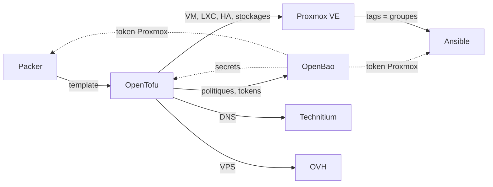

# IaC de mon homelab avec OpenTofu

Le code de mon homelab : un cluster Proxmox VE de trois nœuds et un VPS chez
OVH. Secrets gérés dans OpenBao, enregistrements DNS automatisés vers
Technitium, state distant dans un bucket S3 chez OVH.

C'est le deuxième maillon de ma chaîne d'automatisation : Packer construit
l'image, OpenTofu provisionne les machines, Ansible les configure.

## Contenu de ce dépôt

- **Des machines sur mesure, décrites par des modules dédiés** : chacune est
  dimensionnée pour ses services, et son IP, son ID et son DNS sont déduits
  automatiquement.
- **Aucun secret d'accès dans le state** : token API, clé SSH et clé TSIG du DNS
  sont fournis par des ressources `ephemeral`.
- **Le moindre privilège** : un compte Proxmox par outil, dont les tokens sont
  livrés dans OpenBao.
- **Une CI qui planifie chaque changement** : plan commenté dans la PR, fusion
  automatique dans la branche principale quand il n'y a rien à appliquer.
- **Un cluster existant repris en code** : HA, réplication ZFS, sauvegarde et
  stockages importés, jusqu'à un plan à 0 changement.

## Architecture

Les tags posés sur les machines deviennent les groupes de l'inventaire
dynamique d'Ansible : aucun fichier n'est échangé entre les deux outils.

## Mes choix

- **Les VM ne sont pas immuables** : un nouveau template ne s'applique qu'aux
  nouvelles machines, celles qui existent sont maintenues et conservent leurs
  données.
- **OpenTofu ne gère pas son propre token** : il est créé manuellement, afin que
  l'outil ne puisse pas couper la branche sur laquelle il repose.
- **Le réseau du cluster reste hors du code** : il est configuré à sa mise en
  route, et une erreur couperait un nœud.

## Prochaines étapes

- Renforcer la défense en profondeur : séparer les nœuds et les machines dans
  des VLAN distincts, et gérer en code le pare-feu de Proxmox.
- Réduire les droits de `opentofu@pve`, aujourd'hui `Administrator` sur `/`,
  pour tendre vers un modèle Zero Trust.
- Ajouter une étape de déploiement (CD) après le merge.
- Gérer en code un realm OIDC pour la connexion à Proxmox.
- Sortir le mot de passe PBS du state, quand le provider bpg le permettra.
- Étendre l'IaC à d'autres briques : Proxmox Backup Server, TrueNAS,
  Cloudflare, Forgejo, le réseau (UniFi, MikroTik).

## Organisation

- `proxmox/` : le cluster (machines, stockages, HA, sauvegarde, accès, DNS)
- `openbao/` : la configuration d'OpenBao (politiques, AppRoles, authentification)
- `ovh/` : le VPS
- `modules/` : VM, LXC et enregistrements DNS

## Pour aller plus loin

- [Secrets et state](docs/secrets.md) : où vit chaque secret, comment le state
  est protégé
- [Machines et cluster](docs/machines.md) : les attributs d'une machine,
  l'adressage
- [Intégration continue](docs/ci.md) : du push au merge
- [Utilisation](docs/utilisation.md) : prérequis, commandes, import d'un objet
  existant
- [Rotation des tokens](docs/rotation.md) : la procédure pas à pas

## Licence

[MIT](LICENSE)
